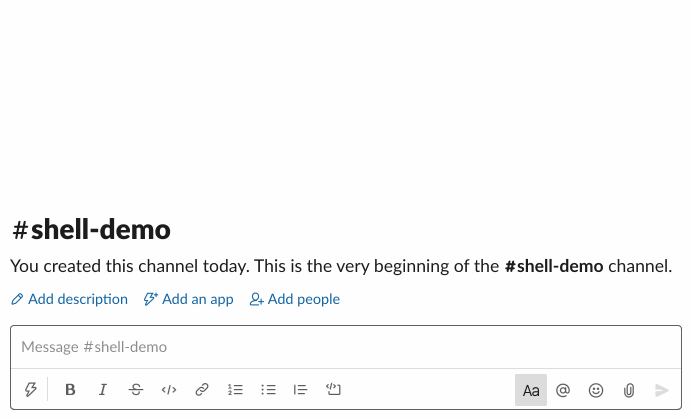

# Slack-Shellbot

A shell bot for Slack. A demo is worth a thousand words.

## Contributing

This bot is built with [slack-ruby-bot-server-events](https://github.com/slack-ruby/slack-ruby-bot-server-events). See [CONTRIBUTING](CONTRIBUTING.md).

## Website artwork

The website follows the shared Slava, Strata, and Strada layout with a terminal-inspired black/charcoal palette (base `#303035`). The editable `public/img/screenshot-background.svg` adapts the shared ribbon artwork and keeps `preserveAspectRatio="none"` on a fixed viewport-sized layer so expanding help does not resize the background. Preserve the original transparent `public/img/icon.png` terminal logo, its matching multi-resolution favicon, and the original `public/img/shell.gif` demonstration when updating the design.

The bot recommendations use local copies of the original logos: `bot-slava.png` and `bot-strada.png` from their respective projects' `public/img/icon.png`, `bot-gamebot.png` from slack-gamebot2's `public/img/game.png`, and `bot-sup.png` from slack-sup2's `public/img/icon.png`. Preserve their original colors rather than applying the Shell website's monochrome styling.

## Website assets and caching

The website uses `rack-server-pages` 0.3.0's `asset_path` helper for content-versioned CSS, JavaScript, images, and favicon URLs. Use the helper for new local asset references rather than fixed URLs or manual version strings. `public/styles.css.erb` is served at `/styles.css` and versions the background image reference too.

The `config.server_pages` block in `config/initializers/slack_ruby_bot_server.rb`, supported by `slack-ruby-bot-server` 2.3.0, sets `Cache-Control: private, no-cache` for templates, including HTML and the generated stylesheet, requiring revalidation before reuse. This lets the stylesheet pick up a changed background image even when its own source is unchanged. Static files use the library's default content-based `ETag` and timestamp validation. Versioned URLs serve current files rather than archived versions; do not add `immutable` or long freshness lifetimes. Existing cached pages need to fetch fresh HTML before they can use the new URLs.

## Copyright and License

Copyright (c) 2016-2025, Daniel Doubrovkine, Artsy and [Contributors](CHANGELOG.md).

This project is licensed under the [MIT License](LICENSE.md).
